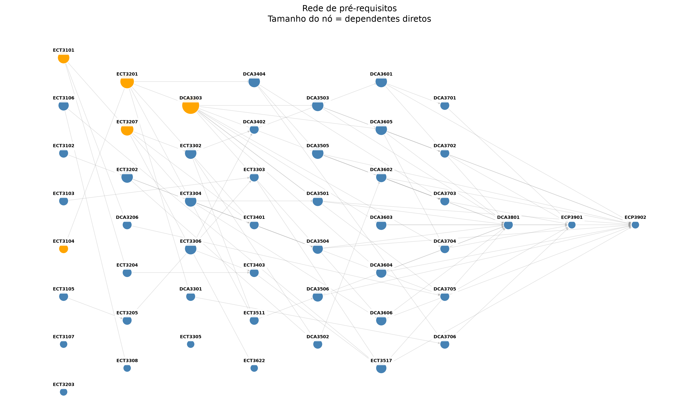
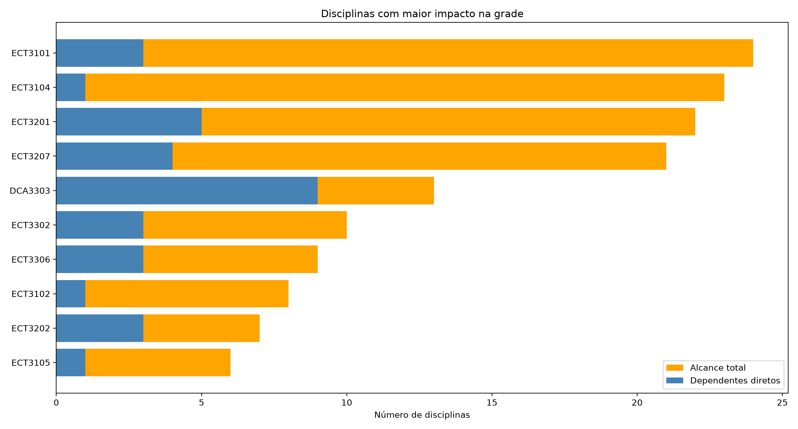
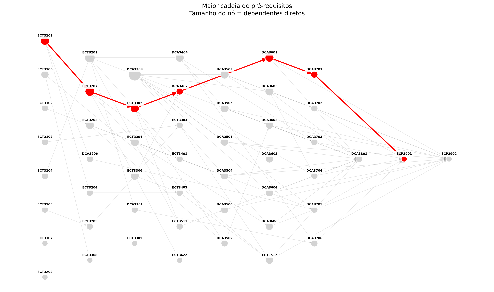

# Análise do Currículo de Engenharia de Computação

**Projeto da disciplina de Algoritmos e Estruturas de Dados II (AED2)**  
**Universidade Federal do Rio Grande do Norte (UFRN) — Campus Natal**

## Integrantes

- **José Renato de Araújo Ribeiro** — [GitHub](https://github.com/jrenatoo)
- **Marcelo Jorge Oliveira de Albuquerque Melo** — [GitHub](https://github.com/marcelomelos)

**Vídeo de apresentação no YouTube:** [INSERIR LINK DO VÍDEO]

## 1. Problema e pergunta de pesquisa

Ao longo da graduação, o estudante precisa cursar uma grande quantidade de disciplinas. Entretanto, fatores como choque de horários, incompatibilidade com a rotina de trabalho e reprovações podem impedir que todas as disciplinas previstas para um semestre sejam concluídas.

Como várias disciplinas exigem a aprovação em outras, deixar de cursar ou não obter êxito em uma matéria pode impedir a matrícula em disciplinas posteriores. Esse efeito pode se estender por vários períodos.

Diante disso, buscamos responder à seguinte pergunta:

> **Quais disciplinas e cadeias de pré-requisitos podem causar maior impacto na progressão curricular da Engenharia de Computação e, por isso, merecem maior atenção no planejamento das matrículas?**

O objetivo não é prever a data exata de formatura, mas identificar **gargalos potenciais** com base nas relações de pré-requisitos.

## 2. Dados utilizados

Os dados foram obtidos a partir da **estrutura curricular 2024.1 do curso de Engenharia de Computação da UFRN, Campus Natal**. A partir dessa estrutura, foram organizados manualmente dois arquivos CSV com as disciplinas obrigatórias e suas relações de pré-requisitos. **As disciplinas optativas não foram consideradas.**

A base utilizada na análise possui **50 disciplinas** e **87 relações de pré-requisitos**.

- [`disciplinas_grade.csv`](Arquivos%20CSV/disciplinas_grade.csv): código, nome, nível, carga horária e pré-requisitos de cada disciplina.
- [`arestas_prerequisitos.csv`](Arquivos%20CSV/arestas_prerequisitos.csv): pares de disciplinas ligados por uma relação de pré-requisito.


O problema foi representado por um **grafo dirigido e não ponderado**, construído com a biblioteca NetworkX.

- **Nós (vértices):** representam as disciplinas. Cada nó possui atributos como código, nome e nível curricular.
- **Arestas dirigidas:** representam as relações de pré-requisito. Se a disciplina A é pré-requisito de B, a aresta é **A → B**.
- **Pesos:** não foram atribuídos pesos às arestas, pois o objetivo é representar a existência e a direção de cada dependência.

Na visualização, **nós maiores indicam disciplinas com maior grau de saída**, ou seja, mais dependentes diretos. Esse tamanho é somente um recurso visual e não representa um peso matemático no grafo.

O grafo foi analisado como um **DAG (grafo dirigido acíclico)**, o que permite buscar a maior sequência de pré-requisitos sem ciclos.

## 4. Relação com os conteúdos da disciplina

| Conteúdo | Semana | Onde aparece no código | Aplicação no projeto |
|---|---|---|---|
| Grafos dirigidos, nós, arestas e atributos | 2 | `nx.DiGraph()`, `add_node()` e `add_edge()` | Representar as disciplinas e o sentido dos pré-requisitos. |
| Grau dos vértices | 2 | `grafo.out_degree(codigo)` | Contar quantas disciplinas dependem diretamente de cada matéria. |
| Busca e alcançabilidade (relacionadas a BFS/DFS) | 3 | `nx.descendants(grafo, codigo)` | Encontrar todos os dependentes diretos e indiretos seguindo a direção das arestas. |
| Caminhos em grafos | 4 | `nx.dag_longest_path(grafo)` | Identificar uma das maiores cadeias sucessivas de pré-requisitos. |
| Visualização e interpretação de redes | 4 | `nx.draw_networkx_nodes()`, `nx.draw_networkx_edges()` e Matplotlib | Mostrar a estrutura da grade e destacar as disciplinas de maior impacto e a maior cadeia. |

**Observação:** a alcançabilidade é calculada pela função `nx.descendants()`, e não por uma implementação manual de BFS ou DFS. Da mesma forma, o caminho mais longo é calculado por uma função pronta do NetworkX.

## 5. Metodologia

Após a leitura dos CSVs com Pandas, o programa cria um grafo dirigido com as disciplinas e as relações de pré-requisito. Em seguida, são realizadas três análises principais:

1. **Dependentes diretos:** utiliza o grau de saída de cada nó para contar quantas disciplinas exigem diretamente aquela matéria.
2. **Alcance total:** utiliza `nx.descendants()` para contar todas as disciplinas alcançáveis a partir de um nó, seguindo as setas. O número de dependentes exclusivamente indiretos é obtido subtraindo os dependentes diretos do alcance total.
3. **Maior cadeia:** utiliza `nx.dag_longest_path()` para encontrar uma das maiores sequências consecutivas de pré-requisitos no grafo.

Os resultados são organizados em tabelas CSV e em três figuras: rede completa, rede com a maior cadeia destacada e gráfico de ranking.

**Código-fonte:** [`projeto_aed2.py`](projeto_aed2.py)

## 6. Resultados e interpretação

### 6.1. Rede completa de pré-requisitos



A figura mostra as disciplinas organizadas por nível curricular e as relações de pré-requisitos entre elas. O tamanho dos nós varia de acordo com o número de dependentes diretos. Na rede completa, as cinco disciplinas com maior alcance total são destacadas em laranja.

### 6.2. Disciplinas com maior impacto



A análise permite distinguir o **impacto imediato** do **impacto acumulado** de uma disciplina.

| Disciplina | Dependentes diretos | Alcance total (diretos e indiretos) |
|---|---:|---:|
| Matemática Básica e Modelagem (ECT3101) | 3 | **24** |
| Lógica de Programação (ECT3104) | 1 | **23** |
| Linguagem de Programação (ECT3201) | 5 | **22** |
| Cálculo Diferencial e Integral I (ECT3207) | 4 | **21** |
| Programação Avançada (DCA3303) | **9** | 13 |

**Programação Avançada** possui o maior número de dependentes diretos: **9**. Isso indica que sua não conclusão pode impedir imediatamente a matrícula em várias disciplinas.

Já **Matemática Básica e Modelagem** apresenta o maior alcance total: **24 disciplinas**, sendo 3 dependentes diretos e 21 exclusivamente indiretos. Portanto, mesmo sem liderar o grau de saída, ela está no início de muitas relações de dependência que se estendem pela grade.

Esses resultados mostram que uma disciplina pode ser importante tanto por bloquear várias matérias imediatamente quanto por estar no início de cadeias de pré-requisitos extensas.

### 6.3. Maior cadeia de pré-requisitos



Foi encontrada uma cadeia máxima com **7 disciplinas e 6 arestas consecutivas**:

1. **ECT3101** — Matemática Básica e Modelagem (1º nível)
2. **ECT3207** — Cálculo Diferencial e Integral I (2º nível)
3. **ECT3302** — Cálculo Diferencial e Integral II (3º nível)
4. **DCA3402** — Modelagem e Análise Linear de Sistemas (4º nível)
5. **DCA3601** — Análise de Sistemas de Controle (6º nível)
6. **DCA3701** — Projeto de Sistemas de Controle (7º nível)
7. **ECP3901** — Trabalho de Conclusão de Curso (9º nível)

Essa sequência evidencia uma cadeia longa de dependências sucessivas. A não conclusão de uma disciplina no início da cadeia pode impedir o avanço nas seguintes, mesmo que elas estejam previstas para níveis posteriores.


### 6.4. Resposta à pergunta de pesquisa

Os resultados indicam que **Programação Avançada** merece atenção pelo alto número de dependentes diretos, enquanto **Matemática Básica e Modelagem**, **Lógica de Programação**, **Linguagem de Programação** e **Cálculo I** se destacam pelo grande alcance total.

Além disso, a cadeia máxima identificada mostra que existem sequências de disciplinas que dependem de aprovações sucessivas. Portanto, ao planejar as matrículas, é útil considerar não apenas o nível curricular de uma matéria, mas também **quantas outras disciplinas dependem dela e quantas etapas existem nas cadeias posteriores**.

## 7. Como instalar e executar

Para executar o projeto, é necessário ter o **Python 3** instalado, além das bibliotecas `pandas`, `networkx` e `matplotlib`.

### Passo 1 — Baixar os arquivos do projeto

Baixe os três arquivos disponíveis no repositório:

- [projeto_aed2.py](https://github.com/jrenatoo/Requisitos_Eng_Comp/blob/main/projeto_aed2.py) — Código principal do projeto.
- [disciplinas_grade.csv](https://github.com/jrenatoo/Requisitos_Eng_Comp/blob/main/Arquivos%20CSV/disciplinas_grade.csv) — Dados das disciplinas da grade curricular.
- [arestas_prerequisitos.csv](https://github.com/jrenatoo/Requisitos_Eng_Comp/blob/main/Arquivos%20CSV/arestas_prerequisitos.csv) — Relações de pré-requisitos.

Coloque os três arquivos na **mesma pasta**, para que o programa consiga acessar os dados corretamente.

### Passo 2 — Instalar o Python

Primeiramente, verifique se o Python já está instalado. Abra o terminal e execute:

```bash
python3 --version
```

No Windows, também é possível utilizar:

```bash
py --version
```

Caso o Python não esteja instalado, utilize uma das opções abaixo, de acordo com o sistema operacional.

**Windows (PowerShell):**

```powershell
winget install --id Python.Python.3.13 -e
```

**macOS (Homebrew):**

```bash
brew install python
```

**Ubuntu/Debian:**

```bash
sudo apt update
sudo apt install python3 python3-pip python3-venv
```

Também é possível instalar o Python pelo [site oficial](https://www.python.org/downloads/).

Após a instalação, abra um novo terminal e verifique se o Python está funcionando.

### Passo 3 — Instalar as bibliotecas

Abra o terminal na pasta do projeto e escolha uma das opções abaixo.

**Opção 1 — Instalação direta**

```bash
python3 -m pip install pandas networkx matplotlib
```

**Opção 2 — Utilizando ambiente virtual (venv)**

Crie o ambiente virtual:

```bash
python3 -m venv .venv
```

Ative o ambiente virtual.

No macOS ou Linux:

```bash
source .venv/bin/activate
```

No Windows (PowerShell):

```powershell
.venv\Scripts\Activate.ps1
```

Com o ambiente ativado, instale as bibliotecas:

```bash
python -m pip install pandas networkx matplotlib
```

O ambiente virtual permite instalar as bibliotecas separadamente das demais instalações do Python no computador, evitando possíveis conflitos.

**Observação:** no Windows, os comandos `python3` podem precisar ser substituídos por `py`. Em algumas instalações do Python, a instalação direta de bibliotecas pode ser bloqueada; nesse caso, utilize a opção com ambiente virtual.

### Passo 4 — Executar o projeto

Com os três arquivos na mesma pasta, abra o terminal nesse diretório e execute:

```bash
python3 projeto_aed2.py
```

Caso esteja utilizando o ambiente virtual, execute:

```bash
python projeto_aed2.py
```

No Windows, sem ambiente virtual, também é possível utilizar:

```powershell
py projeto_aed2.py
```

Após a execução, o programa realizará a análise da rede de pré-requisitos e gerará os seguintes resultados:

- **01_rede_completa.png:** visualização da rede curricular completa.
- **02_maior_cadeia.png:** visualização da maior cadeia de pré-requisitos.
- **03_ranking_impacto.png:** comparação das disciplinas com maior impacto direto e indireto.
- **ranking_disciplinas.csv:** ranking das disciplinas conforme seus dependentes.
- **maior_cadeia.csv:** sequência de disciplinas pertencentes à maior cadeia identificada.

Os arquivos gerados serão armazenados na pasta `resultados`, criada automaticamente pelo programa.
## 8. Arquivos e resultados disponíveis

**Dados de entrada:**

- [Disciplinas da grade](Arquivos%20CSV/disciplinas_grade.csv)
- [Relações de pré-requisitos](Arquivos%20CSV/arestas_prerequisitos.csv)

**Resultados em CSV:**

- [Ranking das disciplinas](resultados%20CSV/ranking_disciplinas.csv)
- [Maior cadeia](resultados%20CSV/maior_cadeia.csv)

**Imagens:**

- [Rede completa](imagens/01_rede_completa.png)
- [Maior cadeia destacada](imagens/02_maior_cadeia.png)
- [Ranking de impacto](imagens/03_ranking_impacto.png)

**Código:** [projeto_aed2.py](projeto_aed2.py)

## 9. Limitações

O modelo analisa somente as relações de pré-requisitos das disciplinas obrigatórias da estrutura curricular selecionada. Assim, possui algumas limitações:

- **Alcance não equivale a atraso real:** uma disciplina alcançar outras 24 não significa que sua reprovação atrasará necessariamente 24 matérias ou a formatura.
- **Maior cadeia não representa automaticamente semestres de atraso:** o comprimento da cadeia indica etapas de dependência, mas não considera quando as disciplinas são ofertadas.
- **Outros fatores não foram modelados:** choques de horário, rotina de trabalho, reprovações, equivalências, limites de créditos, oferta semestral e outras regras de matrícula.
- **Múltiplos pré-requisitos:** quando uma disciplina exige mais de uma matéria, todas as condições devem ser cumpridas. O alcance de um nó não constitui uma simulação completa das matrículas.
- **Dados específicos:** a análise considera somente as disciplinas obrigatórias da grade 2024.1 utilizada e depende da transcrição correta das relações para os CSVs.
- **Cadeias máximas alternativas:** podem existir várias cadeias com o mesmo comprimento; o algoritmo mostra uma delas.

## 10. Conclusão

A modelagem da grade curricular como um grafo dirigido permitiu identificar disciplinas com grande quantidade de dependentes diretos, matérias com influência acumulada sobre várias etapas do curso e uma cadeia longa de pré-requisitos.

O uso de grau de saída, alcançabilidade e caminhos em grafos mostrou como conceitos de Algoritmos e Estruturas de Dados II podem ser aplicados a um problema real da vida acadêmica. Os resultados podem auxiliar o estudante a compreender melhor as dependências curriculares e a planejar suas matrículas, desde que sejam considerados também os fatores práticos que não estão representados no modelo.
